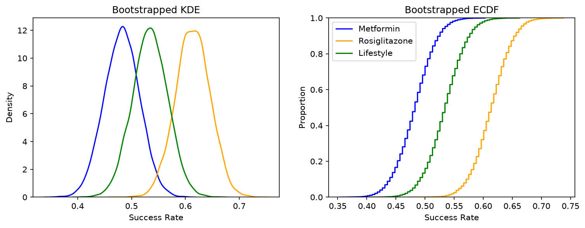
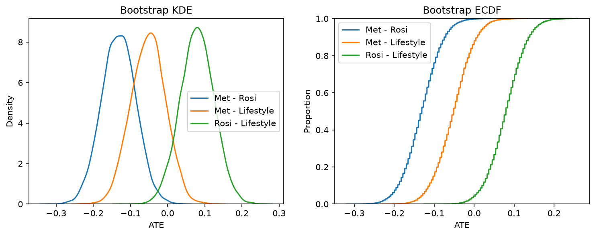

# Report (Q6)

This report reviews the results of a randomized controlled trial in which 699 pre-diabetic patients were assigned to one of three intervention treatments, all with the purpose of slowing the progression from pre-diabetes to type-2 diabetes. The three treatments were Metformin with 232 patients, Rosiglitazone with 233 patients, and lifestyle adjustments with 234 patients. Outcomes for the treatments were deemed either a success or failure (binary) based on whether or not the pre-diabetic patients progressed to having type-2 diabetes. The effectiveness of each individual treatment is captured by its average success rates. Determining if one treatment outperforms another is done through computing average treatment effect (ATE), and seeing how often those ATE estimates excludes 0 at differing confidence levels using 10,000 bootstrapped samples. Hence, inference on treatment effectiveness is based on percentile bootstrap confidence intervals, and takeaways of this analysis are discussed at the end.

Starting with the basics, we can see the average success rate for each treatment group below in Table 1 (pulled for Part 2 Question 1). Here, Rosiglitazone has the highest observed success rate at 61.4%, followed by Lifestyle at 53.4%, and lastly by Metformin at 48.3%. This is basic evidence that Rosiglitazone is the most effective treatment, but to be sure we take it a step further by looking at the distribution of these success rates when we bootstrap them. Seen in Figure 1, the output from Part 2 Question 3, we can observe the bootstrapped KDE and ECDF plots of each treatment groups success rate. The KDE plots show that the densities are centered around the full sample success rates, and that each group has very similar spread. The ECDF plots never cross, implying that at every quantile Rosiglitazone has the highest success rate and Metformin has the lowest success rate. These three pieces of evidence come together to tell the story that Rosiglitazone is the most effective treatment for preventing type-2 diabetes, but to be even more certain we expand upon this by comparing the effectiveness between treatments.

Table 1: Success rates by treatment group

| Arm | N | Successes | Success rate |
|---|---|---|---|
| Metformin | 232 | 112 | 48.3% |
| Rosiglitazone | 233 | 143 | 61.4% |
| Lifestyle | 234 | 125 | 53.4% |

*Figure 1. Bootstrapped KDE (left) and ECDF (right) of each arm's success rate, 10,000 replications.*

After comparing the success rates between treatments groups, results on the ATE's and the confidence intervals at different significant levels can be found in Table 2 (pulled from Part 2 Question 5). Accompanying visuals can be found in Figure 2, showing the distribution of ATE's after bootstrapping. Looking at the first row in Table 2, we see that Rosiglitazone is about 13 percentage points more successful than Metformin, and that this outperformance is statistically significant at all three confidence levels because 0 is not included in the CI's. This is our strongest finding from the comparisons: Rosiglitazone significantly outperforms Metformin at the 99% confidence level. Moving onto the next comparison, the Metformin–Lifestyle ATE is -0.05 which means that the Lifestyle treatment is 5 percentage points more effective than the Metformin treatment. However, this ATE is so close to 0 and 0 is included in all the confidence intervals, meaning that at no confidence level can we reject the null that these treatments have the same effect. Lastly, in the Rosiglitazone-Lifestyle comparison we find an ATE of 0.08, saying Rosiglitazone is 8% more effective than lifestyle. Interestingly, 0 is not included in the CI at 90%, but it is at 95% and 99%, meaning that we can only reject the null of them having the same effectiveness at the lowest confidence level. Visuals of the ATE between these comparison groups can be seen in Figure 2, demonstrating how often the ATE is different than 0. Having tested the three pairwise comparisons, the narrative that Rosiglitazone is the best treatment persists but we cannot say this with full certainty since we do not have enough evidence to reject the null at every confidence level for the two alternative treatments, or even a non-treatment.

Table 2: Pairwise ATE's and percentile bootstrap confidence intervals

| Comparison | ATE | 90% CI | 95% CI | 99% CI | Reject H0 (ATE = 0) |
|---|---|---|---|---|---|
| Metformin − Rosiglitazone | −0.13 | [−0.208, −0.058] | [−0.221, −0.041] | [−0.247, −0.011] | All confidence levels |
| Metformin − Lifestyle | −0.05 | [−0.129, 0.026] | [−0.142, 0.038] | [−0.171, 0.069] | No confidence levels |
| Rosiglitazone − Lifestyle | +0.08 | [0.003, 0.152] | [−0.010, 0.169] | [−0.036, 0.195] | Only 10% confidence level |

*Figure 2. Bootstrapped KDE (left) and ECDF (right) of the three pairwise ATEs.*

Putting this all together, the trial supports prescribing Rosiglitazone over the other two options, outperforming Metformin with statistical significance and only slightly outperforming Lifestyle at the 90% confidence level. That said, this trial and data has some limitations. For example, the data only uses a binary outcome for success which may not capture the full picture, and treatments may prolong the progression from pre-diabetes to type-2 diabetes rather than preventing it which may not be caught if the binary is determined prematurely. More importantly, we do not have data on the success rate for a non-treatment group so we can only compare the effectiveness of treatments amongst themselves and cannot determine the effectiveness relative to a patient not on a treatment plan. Therefore, the results of this trial are enough to recommend the uptake of Rosiglitazone as a treatment for pre-diabetes conditional since it is consistently the best performing group across our analysis, but not enough to give us full certainty.

